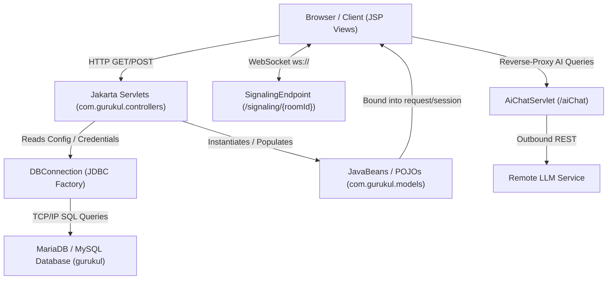

# Gurukul Web Application - Exhaustive Architecture & Code Reference

This master documentation provides an exhaustive, construct-by-construct, method-by-method, and condition-by-condition explanation of **every single file** in the Gurukul Learning Management System (58 files total).

---

## 📑 Detailed Reference Artifacts

To explore the line-by-line internal mechanics of each subsystem, consult the dedicated guides:

1. **[Backend Controllers & Servlets Guide](file:///root/.gemini/antigravity-cli/brain/076a70fd-0442-4f8d-b614-46f015785766/gurukul_controllers_explanation.md)**  
   *Covers 18 Servlets, WebSocket endpoints, and controllers handling authentication, quizzes, grades, classrooms, assignments, WebRTC video calling, and AI chat.*
2. **[Data Models & Utilities Reference](file:///root/.gemini/antigravity-cli/brain/076a70fd-0442-4f8d-b614-46f015785766/gurukul_models_utils_explanation.md)**  
   *Covers all 14 JavaBeans / DTOs (`UserProfile`, `Classroom`, `Quiz`, etc.) and the centralized `DBConnection` connection factory.*
3. **[Frontend JSP Views & Scriptlet Flows Guide](file:///root/.gemini/antigravity-cli/brain/076a70fd-0442-4f8d-b614-46f015785766/gurukul_jsp_views_explanation.md)**  
   *Covers all 25 JSP frontend views, authentication barriers, form dispatchers, and embedded scriptlet database queries.*

---

## 🏛️ System Architecture Overview

---

## 🔍 Core Execution Flows in Detail

### 1. Authentication Flow (`LoginServlet` -> `dashboard.jsp` / `teacherDashboard.jsp`)
- **Trigger**: User inputs credentials in [`login.jsp`](file:///root/gurukul/src/main/webapp/login.jsp) and submits to `POST /LoginServlet`.
- **Constructs & Methods**:
  - `LoginServlet.doPost(HttpServletRequest, HttpServletResponse)`
  - Parameter extraction: `request.getParameter("username")` and `request.getParameter("password")`.
- **Conditional Branches (`if` / `else`)**:
  - `if (username == null || password == null)`: Guard against malformed requests; redirects back with `?error=missing_fields`.
  - `if (rs.next())`: Evaluates database query outcome.
    - **True**: Credentials match. Instantiates `UserProfile`, maps fields (`id`, `fullName`, `role`, `course`, `semester`), and sets session attribute `session.setAttribute("user", profile)`.
    - **False**: Invalid credentials. Sets `request.setAttribute("error", "Invalid credentials")` and forwards back to `login.jsp`.
  - `if ("Teacher".equalsIgnoreCase(profile.getRole()))`:
    - **True**: Redirects to `teacherDashboard.jsp`.
    - **False**: Redirects to student `dashboard.jsp`.

### 2. Classroom & Coursework Stream Flow (`ClassController` -> `class_detail.jsp`)
- **Trigger**: Opening a classroom card from `classes.jsp` or posting a new announcement.
- **Methods**:
  - `ClassController.doGet()`: Handles `action=view` by reading `classId`, querying the `classes` table, joining member enrollment tables, and binding collections of `Announcement` and `Assignment` beans into `request.setAttribute`.
  - `ClassController.doPost()`: Handles classroom actions (`create`, `join`, `postAnnouncement`).
- **Conditional Branches**:
  - `if ("join".equals(action))`: Checks if submitted class code exists in the database.
  - `if (alreadyEnrolled)`: Avoids duplicate key errors by flashing an alert.

### 3. Continuous Assessment & Quiz Scoring (`QuizController` -> `takeQuiz.jsp` -> `quizResult.jsp`)
- **Trigger**: Student starts a quiz, answers questions under a countdown timer, and submits.
- **Methods**:
  - `QuizController.doPost()`: Iterates through submitted question parameter keys (`q_<id>`).
- **Conditional Branches**:
  - `if (selectedOption.equalsIgnoreCase(correctOption))`:
    - **True**: Increments student score by question `marks`.
    - **False**: Awards 0 points for the question.
  - Computes aggregate percentage: `(score * 100.0) / totalMarks`.
  - Inserts into `quiz_submissions` and `quiz_answers` tables.

### 4. Real-time Video Conferencing (`SignalingEndpoint` <-> `meeting.jsp`)
- **Trigger**: Opening `/meeting.jsp?room=<roomId>`.
- **Constructs & Annotations**:
  - `@ServerEndpoint("/signaling/{roomId}")`
  - Lifecycle annotations: `@OnOpen`, `@OnMessage`, `@OnClose`, `@OnError`.
- **Conditional Branches**:
  - `if (!rooms.containsKey(roomId))`: Initializes room session bucket.
  - `if (!peer.equals(session))`: Broadcasts incoming SDP offers/answers or ICE candidates to all *other* peers in the room without echoing back to the sender.
